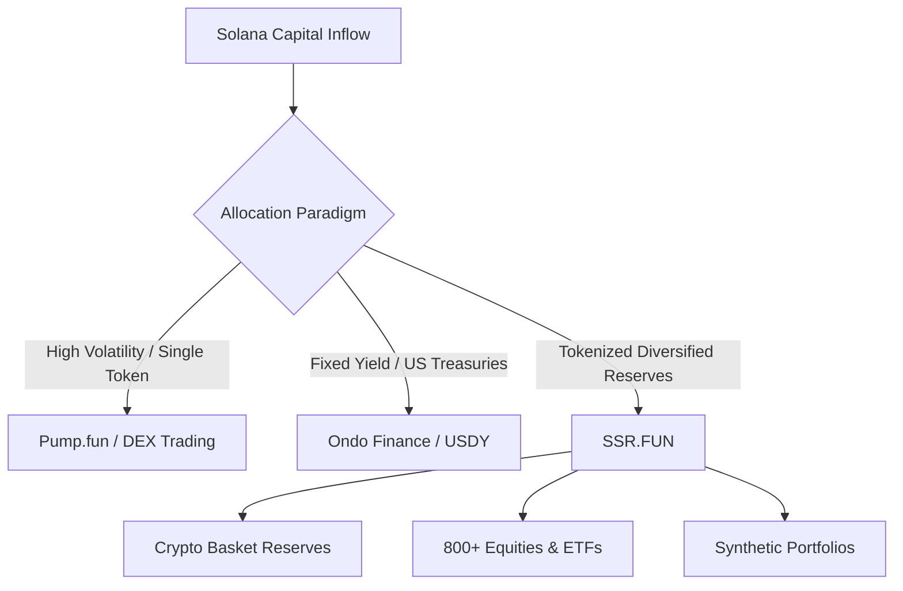

# Strategic Investment Thesis: On-Chain Reserves & Tokenized RWA on Solana

**Author:** Anas Al Shlah  
**Platform Scope:** SSR.FUN & Strategic Super Reserve

---

## 1. The Macro Paradigm Shift: From Memetic Cycles to On-Chain Indices

Decentralized finance on Solana has matured through distinct generational waves:
1. **Wave 1 (AMM & Primitive Liquidity):** Uniswap/Raydium style xy=k invariant pools.
2. **Wave 2 (High-Frequency Speculation & Memecoins):** Pump.fun and high-velocity token factories with extreme turnover.
3. **Wave 3 (Institutional RWA & Tokenized Portfolio Reserves - The SSR Frontier):** The convergence of traditional capital markets with composable Solana primitives.

### The Problem With Dispersed Asset Management
Retail and institutional participants face severe friction when building balanced exposure across:
- Crypto blue chips (SOL, BTC, ETH)
- High-beta ecosystem tokens
- Tokenized equities and ETFs (S&P 500, QQQ, commodity synthetics)

Individual rebalancing incurs multiple swap fees, variable gas spikes, tracking error, and tax complexity. **SSR.FUN** solves this via **Single-Transaction Tokenized Reserves (STRs)**.

---

## 2. Competitive Matrix & Strategic Positioning

| Dimension | Pure Memecoin Launchpads (Pump.fun) | Pure Debt RWA (Ondo, Centrifuge) | **SSR.FUN (Strategic Super Reserve)** |
| :--- | :--- | :--- | :--- |
| **Asset Breadth** | Isolated SPL tokens | US Treasuries / Fixed Income | **Hybrid: Crypto + 800+ Equities & ETFs** |
| **Volatility Profile**| Asymmetric downside (rug risk) | Flat fixed yield (4-5% APY) | **Dynamic, risk-adjusted beta** |
| **Composability** | Minimal (isolated pools) | Semi-permissioned / KYC | **Full Solana DeFi composability** |
| **Target Audience** | Fast-money degens | Institutions / Wealth Managers | **Global retail + algorithmic agents** |

---

## 3. Valuation & Market Sizing Projections (TAM / SAM)

- **Total Addressable Market (TAM):** Global ETF and index fund assets exceed **$12 Trillion**.
- **Serviceable Available Market (SAM):** Crypto-native wealth seeking diversified hedging ($80 Billion+ across Solana/Ethereum).
- **Serviceable Obtainable Market (SOM):** If SSR.FUN captures just **0.5%** of Solana's daily DEX volume ($2B daily average):
  $$\text{Daily SSR Volume} = \$2,000,000,000 \times 0.005 = \$10,000,000 / \text{day}$$
  $$\text{Annual Protocol Fee Run-Rate (at 0.25% fee)} = \$10,000,000 \times 365 \times 0.0025 = \$9,125,000 / \text{year}$$

---

## 4. Investment Thesis Summary

1. **Defensibility through Index Moat:** Users who invest in an index or reserve tend to hold 7x longer than single-token traders, drastically lowering churn.
2. **Asymmetric Risk/Reward for Creators:** Reserve creators earn recurring creator fees on secondary trading volume, incentivizing active curation and market analysis.
3. **Execution Edge:** Solana's 400ms block times and sub-cent fees make frequent algorithmic rebalancing viable without consuming portfolio alpha in gas overhead.
